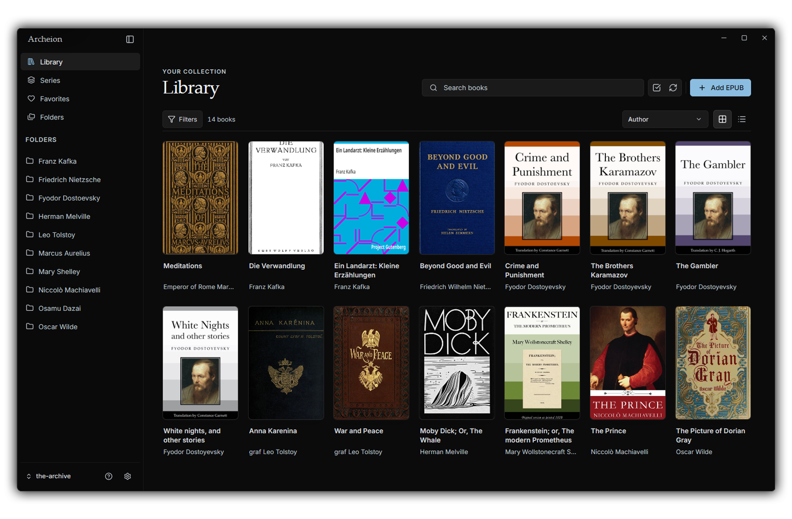

<p align="center">
  <picture>
    <source media="(prefers-color-scheme: dark)" srcset="src/assets/brand/archeion-wordmark-dark.png">
    <source media="(prefers-color-scheme: light)" srcset="src/assets/brand/archeion-wordmark-light.png">
    
  </picture>
</p>

<p align="center">
  A local-first Windows desktop app for organizing and reading EPUB libraries.
</p>

<p align="center">
  <a href="https://tommymoonn.github.io/archeion/"></a>
  <a href="https://github.com/TommyMoonn/archeion/releases/latest"></a>
  <a href="https://github.com/TommyMoonn/archeion/releases"></a>
  <a href="https://tommymoonn.github.io/archeion/documentation/changelog/"></a>
</p>

<p align="center">
  
</p>

---

## About Archeion

Archeion is a local-first EPUB library built around the files already on your machine. If you have a folder full of EPUBs sitting around (for some reason, like me) and want a convenient way to read them on your desktop or laptop, this app is for you.

That's the one specific problem (if you can even call it one) this app is built to solve. Nothing more complicated than that lol.

It's also my personal project for exploring and trying out agentic coding workflows after hating on it for quite a while. It's built primarily for my own use, with experimenting with the tools, techniques, and ideas behind agentic coding being a nice bonus to it.

## AI Usage

I haven't personally written or read a single line of code in this project. All of the code and project documentation are written by LLMs.

Most fixes and improvements come from using the app myself: finding bugs, noticing rough edges, or wanting features that make my own experience using it better. Therefore, a lot of the decisions are very subjective.

Basically, maintenance is vibes-based. Still, all feedback is appreciated, so feel free to open an issue if you run into something or have an idea. I'll fix things as needed (well, _I_, with asterisks around it, to be precise).

## Download Archeion

- **[Windows EXE installer](https://github.com/TommyMoonn/archeion/releases/latest/download/Archeion-Setup-x64.exe)** (recommended)
- **[Windows MSI installer](https://github.com/TommyMoonn/archeion/releases/latest/download/Archeion-x64.msi)**

### Releases

Currently, there's only support for windows systems. No Linux, macOS support yet, I'm too dumb for that right now.

See the [latest release notes](https://github.com/TommyMoonn/archeion/releases/latest)
or browse [all releases](https://github.com/TommyMoonn/archeion/releases).

## Features

- **Real folder archives** - open an existing EPUB folder or create a new archive.
- **Library organization** - browse folders and series, search, sort, filter, select, and manage books in bulk.
- **Bookmarks and highlights** - bookmark, highlight and write notes while reading.
- **EPUB metadata editing** - update a book's metadata such as its title, author, publisher, and more.
- **Customizable appearance** - you can customize the app's theme, refer to the [Custom theme documentation](https://tommymoonn.github.io/archeion/documentation/customization/custom-themes/).
- **Offline dictionaries** - install local dictionaries and look up words you don't know.

## Local-first

An "archive" is literally just a folder on your system. Your books remain ordinary .epub files, while Archeion stores its own data in a `.archeion/` directory inside that folder such as reading progress, annotations/bookmarks, etc.

`.archeion` file structure:

```txt
Your Archive/
├── Meditations.epub
├── Series/
│   └── Crime and Punishment.epub
└── .archeion/
    ├── annotations.json
    ├── library.json
    ├── progress.json
    ├── scanner-cache.json
    ├── covers/
    └── backups/
        ├── annotations/
        ├── epub-writeback/
        ├── library/
        ├── progress/
        └── scanner-cache/
```

## Project documentation

> [!IMPORTANT]
> All of the documentation here are written by LLMs.

- [Devlopment documentation index](docs/README.md)
- [Architecture](docs/ARCHITECTURE.md)
- [Design guidelines](docs/DESIGN.md)
- [Development guide](docs/DEVELOPMENT.md)
- [Testing guide](docs/TESTING.md)
- [Project scripts](scripts/README.md)
- [Changelog](CHANGELOG.md)

## License

Archeion is licensed under the [GNU General Public License v3.0 only](LICENSE).
