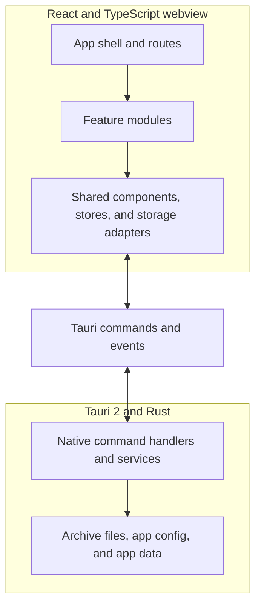

# Archeion architecture

> [!IMPORTANT]
> All of the documentation here are written by LLMs.

Archeion is a local-first Windows desktop application for managing EPUB archives and reading books. The interface runs in a React and TypeScript webview hosted by Tauri 2. The Rust backend handles filesystem access, durable metadata, background work, and desktop integration. Tauri commands and events connect the two sides.

The selected archive remains an ordinary folder on the user's machine. EPUB files stay in that folder. Archeion stores its library metadata and reading state alongside them in a `.archeion` directory.

## System overview

The main window uses React Router for the Library and Reader. The Archive Manager, Settings, About, and Theme Manager run in separate Tauri windows. `src/app/App.tsx` selects the window surface from the Tauri window label or the `window` query parameter.

## Frontend structure

The frontend entry point is `src/main.tsx`. It mounts `src/app/App.tsx`, which starts shared runtimes and selects the correct window composition.

| Location          | Responsibility                                                                                                                                                    |
| ----------------- | ----------------------------------------------------------------------------------------------------------------------------------------------------------------- |
| `src/app/`        | Startup, window selection, routing, application shell, and navigation lifecycle.                                                                                  |
| `src/features/`   | Feature workflows and their UI. Main domains include archive, Library, Reader, folders, series, filesystem actions, settings, themes, updates, and quick actions. |
| `src/components/` | Reusable controls, dialogs, menus, feedback, and other shared UI components.                                                                                      |
| `src/storage/`    | Library data contract, Tauri adapter, command clients, scan coordination, and persistence-related operations.                                                     |
| `src/stores/`     | Application state shared across features and windows, including archive selection and preferences.                                                                |
| `src/themes/`     | Theme definitions, validation, resolution, and appearance runtime.                                                                                                |
| `src/types/`      | Shared domain and cross-layer data contracts.                                                                                                                     |
| `src/utils/`      | General-purpose helpers that do not belong to a feature.                                                                                                          |
| `src/styles/`     | Global tokens, shared component styles, layout styles, and feature styles.                                                                                        |

`src/features/reader/` uses `epub.js` to open and render EPUB publications in the webview. The Reader receives the book file through the storage layer, then manages publication navigation, layout, annotations, and reading interactions.

## Frontend state and storage

`ArchiveStore` owns the known archive registry and active-archive lifecycle. Activation runs through
native activation, path validation, metadata initialization, and final state publication. The store
also owns the long-lived registry event subscription for each application window. It retries a
failed subscription and cleans it up when the window closes. Keep archive initialization separate
from the event subscription lifecycle.

`LibraryStorage` defines the contract for archive and book operations. `TauriArchiveLibraryStorage` is the desktop implementation. The main workspace receives it through `LibraryStorageProvider`. The adapter coordinates book and folder operations, annotations, metadata writes, scans, and watcher updates. Its command clients and operation classes live under `src/storage/tauri/`.

`ArchiveScanSession` supplies a stable Library scan consumer to the native full-scan coordinator.
Native cancellation applies only to a scan for the same archive and consumer. Settings rescan and
metadata repair request reconciliation from the active Library instead of opening a competing
full-scan path. Manual Rescan and watcher follow-up work use that Library scan owner.

`ArchiveMutationCoordinator` applies scan results and other archive changes to the current Library snapshot. Archive-generation checks prevent work started for an old active archive from publishing into the new one.

`AppPreferencesStore` owns normalized application preferences and their update lifecycle. In the desktop app, it reads and writes settings through native commands and listens for settings changes from other windows. `ThemeRepository` uses native commands to manage installed custom theme packages. `src/themes/` resolves the selected appearance and publishes the active theme to the interface.

Keep each piece of shared state with its existing owner. Use `LibraryStorage` for Library and Reader archive operations. Keep window-level state in the owning store or runtime. Keep temporary presentation state in the component that uses it.

## Native backend

`src-tauri/src/main.rs` starts the Rust application through `archeion_lib::run()`. `src-tauri/src/lib.rs` builds the Tauri application, initializes managed services and plugins, handles native window events, and registers the commands available to the webview. `src-tauri/src/commands/mod.rs` groups the command modules.

The native command modules own operations that need direct filesystem or operating-system access. Their responsibilities include:

- Archive registration, activation, path validation, and archive lifecycle events.
- EPUB file access, metadata extraction, cover handling, metadata writeback, and file operations.
- Archive scanning, scanner-cache maintenance, and filesystem watching.
- Durable archive metadata, application settings, and recovery from interrupted writes.
- Dictionary catalog downloads, installation, lookup, and the local dictionary index.
- Custom theme package storage and validation.
- Window management, appearance integration, and application updates.

`src-tauri/src/atomic_file.rs` provides shared support for atomic file replacement and recovery. Native commands use it where a failed write must not leave a partially replaced metadata file.

## Communication between the webview and Rust

The webview calls native commands with Tauri's `invoke` API. It subscribes to native events with `listen`. Rust registers the callable commands in `src-tauri/src/lib.rs` and publishes events through Tauri's event API.

Archive operations usually pass through `LibraryStorage` and its typed command client. Other owners, such as `ArchiveStore`, `AppPreferencesStore`, and `ThemeRepository`, use their own command contracts. Keep command names and payload types aligned across TypeScript and Rust. `scripts/check-tauri-command-parity.mjs` checks that frontend command calls match the native command registration.

The native filesystem watcher publishes `archive://changed` events. `ArchiveWatcherController` debounces and groups those changes before passing them to the storage adapter. The adapter requests a targeted scan when the changed paths are known. It requests a full scan when the event does not provide enough information or the scan state requires reconciliation.

## Data and persistence

Archeion uses separate locations for user archives and application-managed data.

| Location                   | Stored data                                                                                                                                        |
| -------------------------- | -------------------------------------------------------------------------------------------------------------------------------------------------- |
| Selected archive folder    | The user's EPUB files and folders. Archeion does not move the archive into an application-owned database.                                          |
| `<archive>/.archeion/`     | `library.json`, `progress.json`, `annotations.json`, and `scanner-cache.json`, plus cover cache and backup directories.                            |
| Tauri app config directory | `archives.json`, which records known archives, and `settings.json`, which stores application preferences.                                          |
| Tauri app data directory   | Custom theme packages and dictionary data. The dictionary store uses SQLite and keeps installed dictionary files under its managed data directory. |

The archive metadata files have separate responsibilities. `library.json` stores per-book library metadata. `progress.json` stores reading progress. `annotations.json` stores bookmarks, highlights, and notes. `scanner-cache.json` stores metadata used to avoid repeating unchanged EPUB scans. Backup files support recovery and EPUB writeback operations.

The core Library and Reader workflows use local archive files. Some supporting features use the network: dictionary catalog refresh and package downloads, and application update checks and downloads. Local-first describes where the user's library and reading data live. It does not mean every feature is offline-only.

## Dependency boundaries

The frontend import rules are defined in `scripts/check-architecture.mjs` and tested in `tests/architectureBoundaries.test.ts`. The checker enforces allowed dependency directions, rejects production import cycles, and checks cross-feature dependencies. It also prevents production code from importing test modules.

Cross-feature dependencies must be explicit. `scripts/feature-domain-baseline.json` records the approved file-level edges and the reason for each one. Keep those dependencies narrow. Remove baseline entries when the corresponding imports no longer exist. Avoid adding a dependency cycle to solve a local feature problem.

The command parity check covers the TypeScript-to-Rust command boundary. Settings and other shared data contracts also have focused cross-language tests. These checks complement code review. The frontend architecture checker does not validate Rust module design.

Run the architecture, IPC, and settings contract checks described in the
[testing guide](TESTING.md) after changing module dependencies or native command
contracts. See the [development guide](DEVELOPMENT.md) for setup and the
[design guide](DESIGN.md) for visual rules and UI implementation sources of truth.
